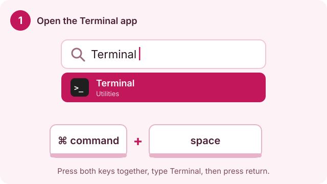
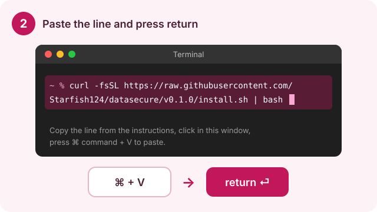
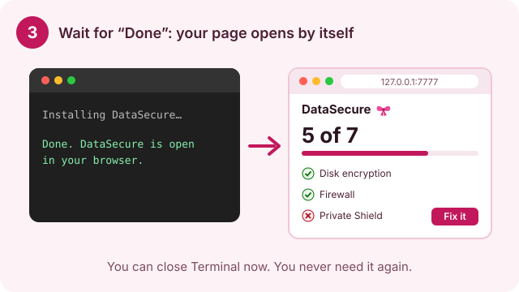
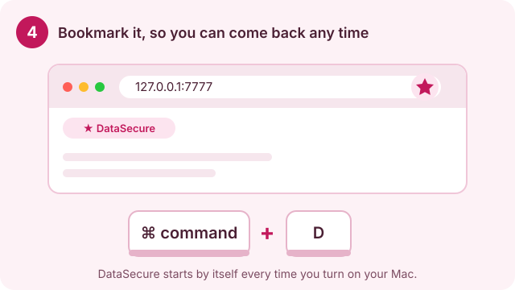
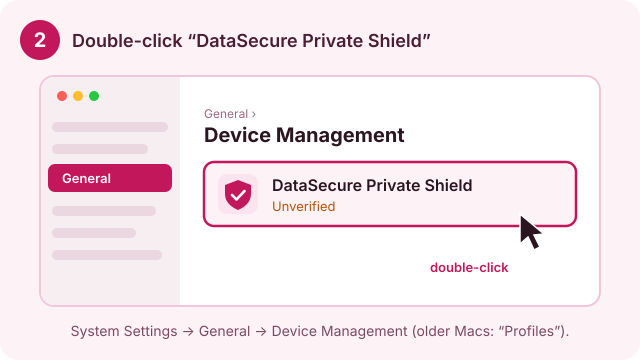
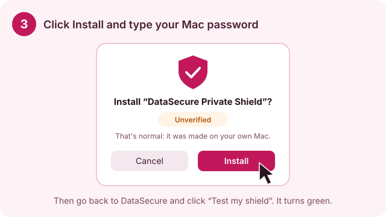

# DataSecure v0.1 

**A free personal cyber protection kit for your Mac, made for people who are not into tech.**
By Sarvesh Singh · MIT License

DataSecure opens a simple page in your browser that runs only on your own Mac. It shows what is protecting you, what isn't, and walks you through fixing it, step by step, in plain words.

| | What it does for you |
|---|---|
| **Checkup** | Checks disk encryption, firewall, automatic updates, screen lock, Find My Mac and Apple ad tracking. Red means "fix this", with the exact steps. |
| **Private Shield** | Encrypts every website lookup so the wifi you're on can't see where you go, and blocks trackers, ads and scam sites. Made fresh on your Mac, just for you. |
| **Leaked passwords** | Checks if a password was ever leaked (without it leaving your Mac), signs you up for instant leak alerts, and warns you on your Mac when a website you use gets hacked. |
| **Where my data goes** | A live list of which app talks to which company, and in which country. |
| **Stay invisible** | Switch off ad profiling at Google, Meta, LinkedIn and Microsoft, and send ready-made legal (GDPR) letters asking data brokers to delete you. |
| **Clear browser data** | Step-by-step wipe of history, cookies and cache in Safari, Chrome and Firefox. |

## Install (3 minutes)

**1. Open the Terminal app.** Press **⌘ Command + Space**, type **Terminal**, press **return**.



**2. Paste this line and press return.** Copy the whole line (the copy button on the right of the box works), click in the Terminal window, press **⌘ Command + V**, then **return**:

```
curl -fsSL https://raw.githubusercontent.com/Starfish124/datasecure/v0.1.0/install.sh | bash
```



**3. Wait for "Done".** DataSecure opens in your browser by itself. You can close Terminal now.



**4. Bookmark the page** with **⌘ Command + D**. Its address is `http://127.0.0.1:7777`, which means "this computer".



**5. Start on the Overview page.** It shows four steps. Take them one at a time.

You never need Terminal again. DataSecure starts by itself when you turn on your Mac.

### Turning on the Private Shield

On the **Private Shield** page, click **Create my shield**. System Settings opens:





## Remove

Open Terminal again and paste:

```
curl -fsSL https://raw.githubusercontent.com/Starfish124/datasecure/v0.1.0/install.sh | bash -s -- --uninstall
```

Then remove the shield in **System Settings → General → Device Management**.

## Your privacy

DataSecure collects nothing and has no account. It never asks for your Mac password and never changes a setting behind your back. Only these things leave your Mac:

- When you check a password: the first 5 characters of its scrambled (SHA-1) fingerprint, to [Have I Been Pwned](https://haveibeenpwned.com/Passwords). Never the password itself.
- Once a day: a download of the public list of hacked companies from Have I Been Pwned.
- Once a month: a download of the public table of who owns which server, from [iptoasn.com](https://iptoasn.com) (public domain).
- If you turn on the shield: your website lookups, encrypted, to [Mullvad DNS](https://mullvad.net/en/help/dns-over-https-and-dns-over-tls) (no logs, no account).

## Good to know

- Works on macOS 13 (Ventura) and newer (tested on macOS 26.1). Needs no extra software: it runs on the Ruby that comes with every Mac.
- The shield is not a VPN. Websites still see your internet address.
- Alerts appear under the name **Script Editor**. If you don't see the test alert, allow notifications for Script Editor in System Settings → Notifications.

## For developers

No dependencies:

| File | Job |
|---|---|
| `datasecure.rb` | Local web server bound to 127.0.0.1, every check, the daily breach job, the offline IP lookup |
| `index.html` | The whole page: tutorials, styles and script inline |
| `install.sh` | Installs to `~/.datasecure`, adds two LaunchAgents (server + daily check), `--uninstall` removes it all |
| `test.sh` | Starts a throwaway server and tests every feature |
| `docs/*.svg` | Illustrated tutorials (README + page) and the ribbon |

Run the tests: `bash test.sh`

Security notes: the server only listens on 127.0.0.1, rejects any request whose `Host` isn't `127.0.0.1:7777`/`localhost:7777` (DNS rebinding), and accepts button presses only with a matching `Origin` and a JSON body (cross-site requests). Passwords are hashed in the browser; the server only ever sees a 5-character prefix.
